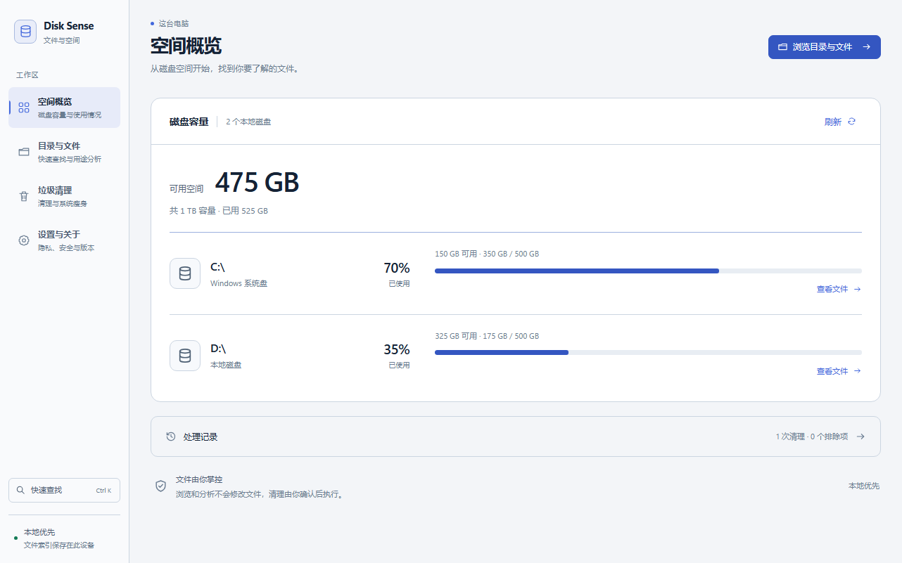
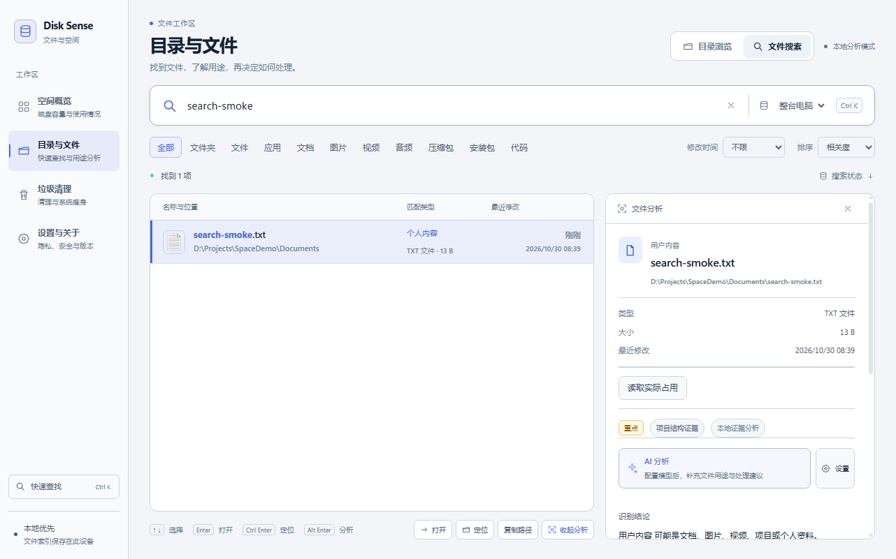
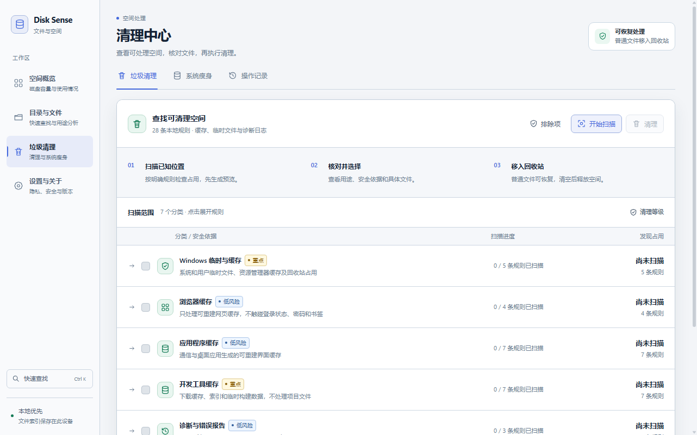

<p align="center">
  
</p>

<h1 align="center">Disk Sense</h1>

<p align="center">
  <strong>先解释空间，再决定处理什么。</strong>
</p>

<p align="center">
  
  
  
  
  
  
</p>

Disk Sense 是一款面向 Windows 的本地优先磁盘空间解释工具，将磁盘概览、文件搜索、用途分析和安全清理放在同一个桌面应用中：

- 这个文件或文件夹究竟是什么，有什么用？
- 哪些软件或项目占用了磁盘，它们的数据分布在哪里？
- 哪些内容可以安全处理，哪些内容必须由用户确认？

项目的核心原则是：**先解释空间关系，再决定是否处理。未知不等于垃圾。**

Disk Sense 不把每个路径看成孤立对象。它会结合 Windows 安装登记、快捷方式目标和目录结构，把程序安装目录、AppData、ProgramData、用户数据、日志和缓存关联到同一个软件；也会通过 `package.json`、`pyproject.toml`、解决方案文件、构建目录等结构标记识别一个项目及其源代码、依赖、构建产物和缓存。清理是空间解释完成后的下游能力，而不是产品起点。

## 为什么做 Disk Sense

传统清理工具擅长识别固定位置中的缓存和临时文件，但用户自己的文件、遗忘的下载内容、跨盘应用数据和来源不明目录通常不在规则范围内。时间久了，即使反复清理，C 盘仍会重新变满。

Disk Sense 采用“目录浏览与搜索 + 文件解释 + 安全清理”的方式：

1. 从 `C:\` 开始，像资源管理器一样浏览目录结构。
2. 结合路径、名称、父级、同级结构、文件特征和有限内容证据判断用途。
3. 在“目录与文件”中快速搜索对象，按需查看软件、项目的关联位置与证据。
4. 对已知低风险项目提供可预览的清理，对未知和个人内容只提供解释与建议。

## 当前能力

| 模块 | 能力 |
| --- | --- |
| 目录与文件 | 常用位置、收藏、返回/前进、筛选排序和大目录分批续读；跨盘搜索支持拼音、词首缩写、多关键词、扩展名和路径，结果分页加载；NTFS 可授权启用 MFT 快照与 USN 增量同步 |
| 文件解释 | 按需查看文件头、扩展名冲突、软件/项目归属与用途证据；读取逻辑大小和实际磁盘分配，标明硬链接、云占位及未确认范围 |
| AI 分析 | 提供 Chat Completions、Responses、Azure 及 Ollama/vLLM 本地兼容接口适配；模型列表手动读取或直接填写；结论关联证据并本地保存，证据或分析版本变化后重新核实 |
| 空间概览 | 查看各磁盘总容量、已用空间与剩余空间，查看处理记录或进入目录浏览 |
| 垃圾清理 | 28 项版本化规则，分别展示“发现占用”和“当前可处理”；支持排除项、进程保护、逐文件校验和回收站清理；覆盖不完整时展示原因 |
| 工具缓存 | 核实 npm、pip、uv、pnpm、NuGet 的版本与缓存位置，展示工具自身的维护命令及影响；共享包存储只观察，命令仅预览 |
| 系统瘦身 | 检测休眠文件、WinSxS、虚拟内存和 Windows.old；明确确认后调用 powercfg、DISM 或打开官方设置；区分完成、需要重启、失败及中断 |
| 操作记录 | 清理计划与逐文件结果持久化、完整明细分页；任务中断后保留未确认结果，人工核对后再处理，不自动重试 |
| 应用归属 | 结合安装登记、当前用户 Appx 包、便携应用清单，以及多种开发生态的项目清单识别归属，保留证据来源与不确定性 |
| 风险体系 | 高风险、较高、重点、低风险、安全五级风险，统一使用红、橙、黄、蓝、绿标识 |
| 设置与关于 | 深色/浅色主题，程序与数据实际位置、占用统计、安全数据迁移、设备信息，以及按需预览与复制的脱敏诊断 |

## 浏览与理解文件

1. 在首页查看磁盘容量，点击“浏览目录与文件”进入主要工作区。
2. 浏览目录或按 `Ctrl+K` 快速搜索；`Enter` 打开对象，`Ctrl+Enter` 在资源管理器定位。
3. 在目录中选择对象，或在搜索中点击“查看分析”（`Alt+Enter`），查看用途、软件/项目关系及本地证据。
4. 需要核对占用时点击“读取实际占用”；需要补充解释时主动发起 AI 分析。
5. 到清理中心扫描已知位置，展开规则核对文件、保留期和覆盖范围，再选择移入回收站。工具缓存的位置核实与维护说明位于相应规则详情中。
6. 在“操作记录”核对处理结果；中断任务中的未确认项应先到回收站或 Windows 维护记录核实，再决定是否重新扫描。

目录和搜索显示的文件大小不是可释放空间。目录名含 `cache` 只是用途线索，不能证明内容可以安全删除。

首次运行需要建立本机索引，已收录的内容可以先搜索。在搜索状态中可启用“开机加速”，首次安装只读搜索服务需要 Windows 管理员确认；普通浏览与搜索无需始终以管理员身份运行。

## 界面预览

三个主要功能模块的浅色界面预览。截图来自真实桌面程序，使用隔离示例数据；磁盘容量和路径仅作演示。

**空间概览** — 查看各磁盘容量、已用与剩余空间，进入目录浏览。



**目录与文件** — 浏览目录、跨盘搜索，按需查看用途分析与证据。



**垃圾清理** — 扫描已知位置，核对覆盖范围与候选文件，预览后确认处理。



## 安全边界

- 默认只移动到 Windows 回收站，不提供永久删除入口。
- 包管理器存储仅观察并提供工具原生管理建议，不通过通用删除拆散缓存索引或链接；发现的用户配置仍需工具自身查询确认。
- 所有批量处理必须先扫描和预览。
- 清理操作只接受当前扫描产生的短期候选标识，不能直接传入任意路径。
- 执行前重新检查路径边界、文件身份、保留时间、进程占用和用户排除项。
- 清理先持久化操作计划和尝试状态，日志不可写时停止执行。外部回收站操作与数据库不能组成同一事务，结果未确认时保留记录，不自动重试；清空普通历史不会移除尚未核对的中断记录。
- 不跟随符号链接、目录联接或逃逸出扫描根目录的路径。
- 未知内容、个人文件和应用数据不会被自动归类为垃圾。
- AI 补充解释时保留本地已确认的风险和归属，分析结果不生成清理权限。
- 系统维护与普通垃圾清理严格分流，只允许程序内置的 Windows 官方命令和固定参数。
- DISM、休眠调整等操作会再次检查管理员权限并要求输入专用确认词；ResetBase 会明确标记为不可逆。
- Disk Sense 不直接删除 WinSxS、分页文件或 Windows.old；虚拟内存和旧版 Windows 安装交由 Windows 官方设置处理。
- AI 是辅助解释层，不拥有删除权限，也不会替代本地安全规则。

安全问题请参阅 [SECURITY.md](SECURITY.md)。

## 隐私与本地数据

- 扫描、文件搜索数据库、清理历史和用户排除项默认只保存在本机；文件搜索只记录名称、路径、大小和修改时间等元数据。
- 文件扫描以元数据为主，只有在解释需要时才读取有上限的文件头部内容。
- AI 功能默认关闭；只有用户主动配置并请求分析时才会发送经过裁剪和脱敏的证据。
- API Key 使用 Electron `safeStorage` 调用 Windows 安全能力加密保存。
- 安装版允许在安装过程中选择程序目录，便携版可直接放在用户选择的磁盘。
- 设置页面会显示程序和本地数据的实际目录、所在磁盘与占用空间。
- 文件搜索数据库会随文件数量增长；当数据位于系统盘且占用较大时，设置页面会主动提示迁移，而不会把自身占用隐藏在 C 盘。
- 本地数据可以迁移到 D 盘等非系统盘：程序先复制并逐文件校验，再写入启动定位信息；首次从新位置启动前会同步迁移后新增的状态，旧目录不会被自动删除。
- 迁移完成并由用户确认旧备份不再需要后，默认目录只需保留一个很小的数据位置指针。
- 诊断默认留在本机。设置中可以预览和复制遮盖密钥、文件路径后的记录，再自行核对并分享。

## 性能策略

- 索引构建和搜索查询分别运行在独立工作线程中；查询通过只读 WAL 连接读取已提交快照，索引发布不会占用查询线程。大候选集合转入 SQLite 磁盘会话，保留完整分页与排序，不通过截断结果控制内存；前 2048 个排序位置使用有界 Top-K，完整排序索引按深分页需要建立。
- 目录打开先返回名称与类型，再只为屏幕上可见的行补充大小、时间和目录抽样统计，避免进入大目录时等待全部文件完成分析。
- 文件用途解释只在用户选中对象后读取内容证据，读取上限为 32 KiB；内容、父级和子级上下文并行获取。
- 原生图标和跨盘应用位置采用有界并发与缓存，连续滚动、搜索和切换页面时不会一次发起大量系统调用。
- NTFS 快照先写入影子表，校验完成后事务发布；USN 变更保存批次检查点，中断后继续回放，避免失败时覆盖已有索引。
- 同轮垃圾扫描共享有界目录读取；规则仍分别检查保留期、保护条件和排除项，读取失败会计入覆盖报告。

## 已知限制

- **尚未达到与 Listary 等价的即时体验。** 首次建库、大量变更补收和宽查询的首次召回、排序仍需时间。构建与查询已分离，发布期间可查询上一份已提交数据；大结果的磁盘会话会增加 SQLite 临时文件占用，连接关闭后释放。缓存预算约束保留的候选数据，不等于整个进程的 RSS 上限。
- 大目录读取采用分批方式；尚未读完时，筛选和排序只覆盖已加载条目。自动续读达到一轮数量上限后，可点击“继续读取目录”。
- 实际分配测量有时间和条目上限，不包含全部文件系统元数据及其他数据流；硬链接、云占位和权限问题会影响判断，显示占用不等于删除后可释放空间。
- AI 协议已有夹具测试，但未逐一验证所有真实服务端点；文件格式线索和 AI 结论都不能证明文件安全或赋予清理权限。
- 已验证 Windows 解包程序；安装升级、卸载保留、真实服务重启和不同云文件提供器仍需要独立环境验收。

## 开发运行

### 环境要求

- Windows 10/11 x64
- Node.js 24（本地验证与 CI 使用的版本）
- pnpm 11.9.0

```powershell
corepack enable
corepack prepare pnpm@11.9.0 --activate
pnpm install
pnpm dev:desktop
```

如果系统仍提示无法识别 `pnpm`，可执行 `npm install -g pnpm@11.9.0` 后重新打开 PowerShell。

依赖安装会下载并校验 Electron 桌面运行文件，需要能够连接 GitHub 下载服务。若网络中断导致运行文件缺失，可在网络恢复后执行 `node node_modules/electron/install.js` 再启动。

`pnpm dev:desktop` 会同时启动 Vite 和真实 Electron 桌面应用：

- Vue、TypeScript 和 CSS 修改会在当前窗口热更新。
- `desktop/` 下主进程或 preload 模块变化时，只重启一个 Electron 窗口。
- 真实文件系统、Windows API 和 IPC 功能必须在桌面开发模式中验证，不能用普通网页预览代替。

常用命令：

```powershell
pnpm typecheck          # TypeScript / Vue 类型检查
pnpm typecheck:desktop  # 关键后端边界模块 checkJs
pnpm test               # 单元、安全和故障注入测试
pnpm check:desktop      # Electron 模块语法检查
pnpm smoke:development  # 启动真实 Electron，执行开发模式冒烟
pnpm benchmark:search   # 在受控临时目录中测量索引吞吐、搜索延迟和界面线程延迟
pnpm benchmark:bounded-search 100000 # 合成大结果集的搜索与分页基准
pnpm validate           # 完整本地质量检查
pnpm pack               # 检查并生成 Windows 解包程序
pnpm check:package      # 检查 release/win-unpacked 的 ASAR 文件及 Electron fuses
pnpm release:win        # 构建 Windows 安装版和便携版
```

`pnpm validate` 包含类型检查、测试、桌面模块语法检查和生产构建；真实 Electron 冒烟与生产包检查需分别执行。单独运行 `pnpm dev` 仅提供网页预览。

## 验证记录

2026-10-30 的本地验证结果：

- 53 个测试文件、448 项测试通过；Vue 与关键后端类型检查、55 个桌面模块语法检查、生产构建通过。
- 真实 Electron 开发版完整页面巡检、打包版高级搜索及浅色界面冒烟通过；ASAR 11 个必需文件与 5 个安全 Fuses 核验通过。
- 本机 10 万条匹配的合成索引测试中，四种排序的首次引擎查询约 0.76–1.32 秒。单次测量不等于 GUI 输入延迟，深分页仍需完整排序索引成本。
- 安装升级、卸载保留、真实服务重启等尚未在独立 Windows 环境验收；已提供手动触发的临时 Windows 验收工作流。远端运行状态见 [GitHub Actions](https://github.com/IC-sd/disk-sense/actions)。

详细结果与性能边界见 [本轮续修验证](docs/continuation-validation-2026-10-29.md)，独立系统测试见 [Windows 验收清单](docs/windows-acceptance.md)。这些验证使用隔离夹具，不代表已执行真实用户文件清理、系统维护或收费 AI 请求，也不代替多设备长期验证。此前功能验收见 [18 项功能实现与验收](docs/functional-implementation-2026-10-27.md)。

## 项目结构

```text
desktop/                Electron 主进程、preload、安全清理与扫描核心
src/                    Vue 3 + TypeScript 用户界面
tests/                  单元、安全边界、状态恢复和性能约束测试
docs/                   产品、安全、架构和本地运维文档
.github/workflows/      GitHub Actions 持续集成
```

## 版本状态

当前源码版本为 **0.9.0-beta.9 公开测试版**。历史空间变化数据仍会保留，当前界面不提供空间变化追踪入口。源码推送不会自动生成安装包；可下载的安装版、便携版及 SHA-256 校验文件以 [GitHub Releases](https://github.com/IC-sd/disk-sense/releases) 中实际发布的资产为准。

当前公开测试构建尚未配置可信 Authenticode 证书，Windows SmartScreen 可能显示“未知发布者”；下载后请使用 Release 中的 SHA-256 文件核对完整性。

仓库早期曾创建 `v1.0.0` 标签，但项目尚缺少足够的真实用户反馈和多设备长期验证。本次主动把成熟度重新校准到 0.9 测试阶段；历史标签保留用于追溯，不代表当前稳定性判断。

达到 1.0 稳定版前仍需：

- 使用可信 Authenticode 证书签名安装包和应用程序。
- 在全新的 Windows 虚拟机中完成每个发布标签的安装验证。
- 收集公开测试用户在真实文件、搜索和清理场景中的反馈。
- 在不同 Windows 版本、硬件和长期使用环境中验证安全性与稳定性。

设计取舍、开源参考与快捷键集中在 [设计约定](docs/design.md)。配置细节见 [AI 接入](docs/ai-integration.md)，版本变化和安全边界见 [更新日志](CHANGELOG.md) 与 [清理安全模型](docs/cleanup-safety.md)。

垃圾清理模块的源码研究、扫描去重、覆盖诊断与后续能力缺口见 [清理开源研究与改进](docs/cleanup-architecture-research.md)。

18 项功能的原始设计与 25 个开源项目对照见 [功能优化与开源对照](docs/functional-optimization-open-source.md)；该研究文档与后续实施结果分开记录。

## 许可证

本项目采用 [MIT License](LICENSE)。
